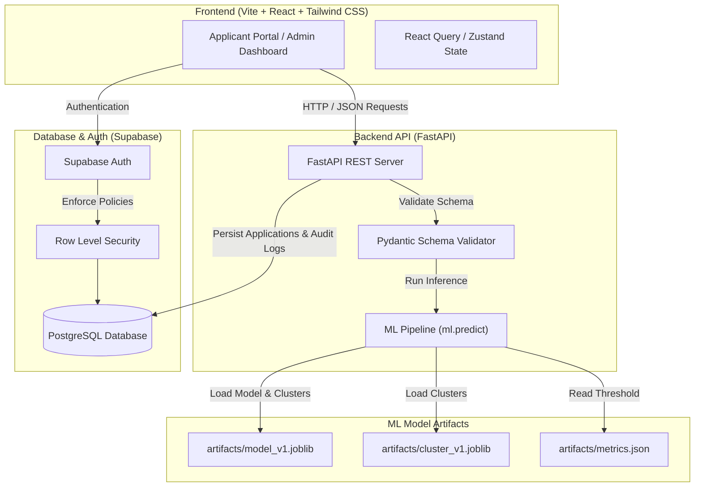

# CredNexa Architecture & Technical Specification (`TECH.md`)

> **System Blueprint:** Production-ready web platform for CredNexa automated loan eligibility prediction, risk analytics, applicant decision management, and model monitoring.

---

## 1. System Architecture Overview

CredNexa integrates a modern decoupled architecture: a **Vite + React** single-page application (styled with **Tailwind CSS**), a **FastAPI** microservice executing the `ml.predict` inference engine, and **Supabase** for PostgreSQL persistence, authentication, and Row Level Security (RLS).



---

## 2. Technology Stack

### 2.1 Frontend Framework & Styling
- **Build Tool:** [Vite](https://vitejs.dev/) (Lightning-fast HMR and bundle optimization)
- **UI Framework:** [React 18+](https://react.dev/) (Functional components, custom hooks)
- **Styling:** [Tailwind CSS v3+](https://tailwindcss.com/) (Utility-first styling, glassmorphism, responsive grid, dynamic dark/light themes)
- **Icons:** `lucide-react`
- **Data Visualization:** `recharts` (Probability gauges, credit score meters, ROC/Confusion Matrix charts)
- **HTTP Client:** `axios` or native `fetch` with `@tanstack/react-query`

### 2.2 Backend Microservice
- **Framework:** [FastAPI](https://fastapi.tiangolo.com/) (Async Python 3.10+ web framework)
- **Data Validation:** `pydantic` v2 (Strict input/output DTO schemas)
- **ML Integration:** Scikit-learn 1.7+, Pandas, NumPy, Joblib
- **API Documentation:** Interactive OpenAPI Swagger UI (`/docs`) & ReDoc (`/redoc`)
- **CORS:** `fastapi.middleware.cors.CORSMiddleware`

### 2.3 Database, Auth & Storage
- **Platform:** [Supabase](https://supabase.com/)
- **Database:** Managed PostgreSQL 15+
- **Security:** Row Level Security (RLS) policies ensuring users only query their own applications while admins access system-wide analytics.
- **Auth Provider:** Supabase Auth (JWT bearer tokens, email/password or OAuth)

### 2.4 LLM Reasoning Engines
- **Primary Model:** [Google Gemini](https://ai.google.dev/) (`gemini-1.5-flash`) - Generates narrative explanations, decision drivers, and applicant risk summaries based on model outputs.
- **Fallback Provider:** [Groq Cloud](https://groq.com/) (`llama-3.3-70b-versatile`) - Automatic high-availability API fallback in case of primary model rate-limits or service outages.

---

## 3. Database Schema (Supabase PostgreSQL)

### 3.1 `profiles` Table
Stores extended user profile information.

```sql
CREATE TABLE public.profiles (
    id UUID PRIMARY KEY REFERENCES auth.users(id) ON DELETE CASCADE,
    email TEXT UNIQUE NOT NULL,
    full_name TEXT,
    role TEXT DEFAULT 'applicant' CHECK (role IN ('applicant', 'admin')),
    created_at TIMESTAMPTZ DEFAULT NOW(),
    updated_at TIMESTAMPTZ DEFAULT NOW()
);
```

### 3.2 `loan_applications` Table
Stores applicant form inputs, model inference results, probabilities, and recommendations.

```sql
CREATE TABLE public.loan_applications (
    id UUID PRIMARY KEY DEFAULT gen_random_uuid(),
    user_id UUID REFERENCES public.profiles(id) ON DELETE SET NULL,
    applicant_name TEXT NOT NULL,
    applicant_income NUMERIC(12, 2) NOT NULL,
    coapplicant_income NUMERIC(12, 2) DEFAULT 0.0,
    loan_amount NUMERIC(12, 2) NOT NULL, -- in thousands (INR)
    loan_amount_term NUMERIC(6, 2) DEFAULT 360.0, -- in months
    credit_history TEXT DEFAULT 'Unknown' CHECK (credit_history IN ('1', '0', 'Unknown')),
    property_area TEXT CHECK (property_area IN ('Urban', 'Semiurban', 'Rural', 'Metro')),
    married TEXT CHECK (married IN ('Yes', 'No', 'Unknown')),
    education TEXT CHECK (education IN ('Graduate', 'Not Graduate', 'Unknown')),
    self_employed TEXT CHECK (self_employed IN ('Yes', 'No', 'Unknown')),
    dependents TEXT CHECK (dependents IN ('0', '1', '2', '3+', 'Unknown')),
    
    -- Model Output Contract
    decision TEXT NOT NULL CHECK (decision IN ('Approved', 'Rejected')),
    probability NUMERIC(5, 4) NOT NULL,
    decision_threshold NUMERIC(5, 4) NOT NULL,
    segment_id INT DEFAULT 0,
    segment_name TEXT,
    top_factors JSONB,
    suggestions JSONB,
    model_version TEXT DEFAULT 'v1',
    created_at TIMESTAMPTZ DEFAULT NOW()
);
```

### 3.3 `model_runs` Table
Stores admin training audit history and benchmark performance logs.

```sql
CREATE TABLE public.model_runs (
    id UUID PRIMARY KEY DEFAULT gen_random_uuid(),
    model_version TEXT UNIQUE NOT NULL,
    cv_accuracy NUMERIC(5, 4),
    cv_roc_auc NUMERIC(5, 4),
    holdout_accuracy NUMERIC(5, 4),
    holdout_roc_auc NUMERIC(5, 4),
    chosen_threshold NUMERIC(5, 4),
    best_params JSONB,
    metrics_summary JSONB,
    created_at TIMESTAMPTZ DEFAULT NOW()
);
```

---

## 4. FastAPI REST API Specification

### 4.1 Endpoint Overview

| Method | Endpoint | Access | Description |
| :--- | :--- | :--- | :--- |
| `GET` | `/api/v1/health` | Public | System status and active model version. |
| `POST` | `/api/v1/predict` | Authenticated / Public | Submits loan application form, runs `ml.predict`, returns result contract. |
| `GET` | `/api/v1/applications` | Authenticated User | Lists past applications for the logged-in user. |
| `GET` | `/api/v1/applications/{id}` | Authenticated User | Retrieves detailed loan assessment report by ID. |
| `GET` | `/api/v1/admin/metrics` | Admin | Fetches system metrics, confusion matrix, ROC data, and model run history. |

### 4.2 Application Assessment Contract (`POST /api/v1/predict`)

#### Request Payload Schema:
```json
{
  "applicant_name": "Jane Doe",
  "ApplicantIncome": 55000,
  "CoapplicantIncome": 15000,
  "LoanAmount": 250,
  "Loan_Amount_Term": 360,
  "Credit_History": "1",
  "Property_Area": "Semiurban",
  "Married": "Yes",
  "Education": "Graduate",
  "Self_Employed": "No",
  "Dependents": "1"
}
```

#### Response Contract Schema:
```json
{
  "id": "c8f3e56a-1234-4567-89ab-cdef01234567",
  "decision": "Approved",
  "probability": 0.86,
  "threshold": 0.4145,
  "segment": {
    "id": 1,
    "name": "Dual-Income Household, Standard Loan Size"
  },
  "top_factors": [
    {
      "feature": "Positive Credit History",
      "direction": "positive",
      "impact": 0.944
    },
    {
      "feature": "Semiurban Property Location",
      "direction": "positive",
      "impact": 0.235
    },
    {
      "feature": "Loan Size relative to Income",
      "direction": "negative",
      "impact": -0.166
    }
  ],
  "suggestions": [],
  "model_version": "v1",
  "created_at": "2026-10-02T16:30:00Z"
}
```

---

## 5. Frontend Pages & Component Tree

```
src/
├── components/
│   ├── layout/
│   │   ├── Navbar.jsx          # Dark/Light mode toggle, Auth state
│   │   ├── Footer.jsx
│   │   └── Sidebar.jsx         # Admin Navigation
│   ├── forms/
│   │   ├── LoanApplicationForm.jsx # Step-by-step form with live validation
│   │   └── FormInput.jsx
│   ├── dashboard/
│   │   ├── ProbabilityGauge.jsx   # Radial score meter for P(Approved)
│   │   ├── ExplainabilityCard.jsx # Feature impact bar chart & indicators
│   │   ├── SuggestionsCard.jsx    # Actionable recommendations
│   │   └── SegmentBadge.jsx       # Applicant risk segment pill
│   └── admin/
│       ├── ConfusionMatrixPlot.jsx
│       ├── RocCurvePlot.jsx
│       └── ApplicationTable.jsx
├── pages/
│   ├── Home.jsx                # Hero section & system overview
│   ├── Assessment.jsx          # Live prediction form & instantaneous report
│   ├── History.jsx             # User past application records
│   ├── AdminDashboard.jsx      # System analytics, confusion matrix & metrics
│   └── Login.jsx               # Supabase auth login/signup
└── services/
    ├── api.js                  # Axios client calling FastAPI backend
    └── supabaseClient.js       # Supabase Client initialization
```

---

## 6. Execution & Deployment Setup

### 6.1 Backend Setup (FastAPI Microservice)
```bash
# 1. Navigate to project root
cd CredNexa

# 2. Install dependencies
pip install -r requirements.txt fastapi uvicorn supabase

# 3. Launch FastAPI server
uvicorn main:app --reload --host 0.0.0.0 --port 8000
```

### 6.2 Frontend Setup (Vite + React)
```bash
# 1. Create Vite React App in frontend folder
npx -y create-vite@latest frontend --template react

# 2. Navigate and install dependencies
cd frontend
npm install lucide-react recharts @supabase/supabase-js axios @tanstack/react-query tailwindcss postcss autoprefixer

# 3. Initialize Tailwind CSS
npx tailwindcss init -p

# 4. Run local development server
npm run dev
```

---

## 7. Compliance & Responsible ML Disclaimer

> **Academic & Educational Disclaimer:** CredNexa is built for educational decision support and risk analytics demonstration. The predictions reflect historical loan approval criteria and do not constitute legal or binding financial commitments.
